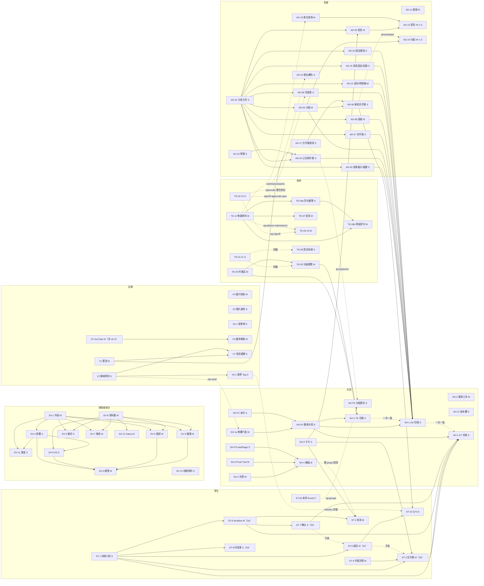

# 六份規格的整合排程（IN）：總排程

- 日期：2026-10-16 14:00 起算。程式基準 `origin/main` `c0f32bd`。
- 讀的規格版本（各分支最新 commit）：共用 SH `3e6b49d`（第 2 輪複查中，暫定）、訪客 VI `6a06d22`（PROCEED-A）＋第 1 批 `claude/visitor-batch-spec-r3b` `7520079`、學生 ST `00dc09b`（A 定稿）、老師 TE `9e52415`（r4，暫定）、系辦 AD `3dcae48`（r4 收尾中，暫定）、開發者後台 DV `0e3983d`（定稿）。
- 權威：定案頁 §0（A＝10/18 18:00 前合併、只動畫面）、§8（Q103～Q129 已定；Q130～Q159 待 Roy）；Q102 合併條件：Review 程式模式 PASS＋CI 全綠＋相依順序＋10/18 18:00 前。
- **本頁的時間比各規格自己的時程優先**。各規格寫在 10/18 12:00 之後才合併的程式票（學生 ST-2 13:00、ST-10 15:00；老師 TE-10 14:00；共用切換票到 18:00）一律提前到 12:00 前，或照 `砍項清單.md` 移 B。

## 0. 規則

1. **10/18 12:00 程式合併檢查點**：之後只合三種 PR：整合驗收發現的修正（只改出問題那張票的可改檔案）、文件票、revert。沒合的程式票照 `砍項清單.md` 移 B。
2. **合併佇列**：主腦一次只合一張動到「共用登記檔」（§3.1）的 PR。合併前 PR 先 rebase 到最新 main，在 rebase 後的 head 上重跑 CI（7～10 分鐘），綠了才合。
3. **估時**：S 約 3 小時、M 約 5 小時，指一位實作者從開工到自我驗收（老師票用 TE 規格自己的時數）。到合併再加 Review 1.5 小時、CI 0.2 小時；表裡的「目標合併」另留一輪 REVISE（約 2.5 小時）。
4. **側欄切換票一次只開一張**：SH-1-TE → SH-1-AD → SH-1-ST，按前置齊備的先後。前一張合併後，下一張才 rebase、交 review。
5. 規格「暫定」的三份（SH、TE、AD）若還有小改，只要不動可改檔案與相依，本排程照用；動了就回報整合架構師改這張表。

## 1. 相依圖

實線＝硬相依（前一張合併後才能合併）；虛線＝同檔先後（後者 rebase）或軟相依。`INT`＝10/18 下午的整合驗收。

（DV-10 → DV-13、各規格文件票、`INT` 不畫，見 §2 表。）

## 2. 波次表

全域波次：**W0** 已開工（10/16 14:00～14:20）｜**W1** 規格放行後立刻開（10/16 15:00～18:00）｜**W2** 前置合併後開（10/16 晚～10/17 上午）｜**W3** 10/17 白天｜**W4** 側欄切換與 Q73 收尾（10/17 下午～10/18 上午）｜**W5** 10/18 12:00～17:00 整合驗收與文件。

「最晚合併」＝這張再晚，下游就排不進 10/18 12:00（或該規格自己的檢查點）。過了最晚合併還沒合 → 查 `砍項清單.md`。

### 2.1 訪客 VI（第 1 批 V1～V8＋本批 VA）

| 票 | 大小 | 硬相依 | 可改檔案摘要 | 實作 h | 波 | 最早開工 | 目標合併 | 最晚合併 |
|---|---|---|---|---|---|---|---|---|
| V1 | M | — | migration 0014、`items` 模組、`admin/affairs/{actions,affairs-list,page}`、`_ui/public-content.tsx`、`competitions/page.tsx`、`item-pin.spec.ts` | 5 | W0 | 已開工 | 10/17 00:00 | 10/17 06:00（AD-04、V7） |
| V2 | S | — | `_ui/site-contact.ts`、首頁 `page.tsx`、`_ui/site-shell.tsx`、`forgot-password/page.tsx`、`industry/page.tsx:144-145`、`home-settings.spec.ts`（只加） | 3 | W0 | 已開工 | 10/16 21:00 | 10/17 02:00（過了就與 SH-1a 對調，見 §3.2） |
| V3（含 VA-4） | M | — | `showcase/{video,draft,index}`、`composition/showcase-video.ts`、`projects/[id]/page.tsx`、`admin/showcase/{actions,showcase-forms}`、`scripts/demo/data.mjs`、`public-projects.spec.ts`、`signoff.spec.ts:241`、新 spec | 5 | W0 | 已開工 | 10/17 00:00 | 10/17 06:00（V6） |
| V4 | M | — | `application/ops/files*`、`ops/index.ts`、`file-storage*`、`composition/files.ts`、`api/files/[id]/route.ts`、`file-download-pages.spec.ts` | 5 | W0 | 已開工 | 10/17 00:00 | 10/18 08:00 |
| V5 | S | — | `news/[id]/page.tsx`、`_ui/photo-dialog-grid.tsx`、`projects/page.tsx`、新 spec | 2 | W0 | 已開工 | 10/16 21:00 | 10/18 08:00 |
| VA-1 | S | — | `honors/page.tsx:77-91`、新 `honors-entry.spec.ts` | 2 | W0 | 已開工 | 10/16 21:00 | 10/18 08:00 |
| VA-2 | S | V2 | `industry/page.tsx:43`、`industry/[id]/page.tsx:92`、新 `industry-tag.spec.ts` | 2 | W2 | V2 合併後 | 10/17 04:00 | 10/17 12:00（ST-10 要從它之後的 main 開） |
| V6 | M | V3 | `showcase/{ports,public,index}`、`composition/showcase.ts`、`pg-public-showcase*`、`projects/featured/page.tsx`、新 spec | 5 | W2 | V3 合併後 | 10/17 09:00 | 10/18 08:00（不行就照第 1 批砍項 B 縮小） |
| V7 | S | V1、V2 | 首頁 `page.tsx`（競賽排序）、`_ui/public-content.tsx`、`item-pin.spec.ts` | 2 | W2 | V1、V2 合併後 | 10/17 06:00 | 10/18 08:00 |
| VA-5（含 V8） | S | — | 模組 04／09／10、前台與後台頁面清單、契約 02／03、`docs/product/CONTEXT.md`、本規格目錄 | 2 | W5 | 隨時 | 10/18 14:00 | 10/18 17:00（或 10/19，見砍項 2） |

### 2.2 開發者後台 DV（`status/**`；合併權限等 Q158）

| 票 | 大小 | 硬相依 | 可改檔案摘要 | 實作 h | 波 | 最早開工 | 目標合併 | 最晚合併 |
|---|---|---|---|---|---|---|---|---|
| DV-1 | M | — | `status/src/lib/data/nav.ts`、側欄四元件、`globals.css`、`layout.tsx`、四個占位頁、`/map` 改字、`hosts.ts:12`、`scripts/bundle-size.mjs`、`test/shell.test.tsx`、`overview.test.tsx:30`、`map.test.tsx:287` | 5 | W0 | 已開工 | 10/16 23:00 | 10/17 12:00（DV 檢查點 A1） |
| DV-8 | M | — | collector `vm`／`shapes`／`collect`＋測試、`src/lib/data/types.ts`、fixtures | 5 | W0 | 已開工 | 10/16 23:00 | 10/17 12:00 |
| DV-10 | S | — | `docs/status/test-map.json`、`docs/status/README.md:43` | 2 | W0 | 已開工 | 10/16 20:00 | 10/18 08:00 |
| DV-4 | S | DV-1 | `status/src/app/deploy/page.tsx`、`lib/deploy/*`、`test/deploy.test.tsx` | 3 | W2 | DV-1 合併後 | 10/17 06:00 | 10/17 12:00（不砍；DV-9／11／2 都等它） |
| DV-9 | S | DV-8；合併等 DV-4 | `src/lib/gate/*`、`components/gate-card.tsx`、`app/go-live/page.tsx`、`test/go-live.test.tsx` | 3 | W2 | DV-8 合併後 | 10/17 09:00 | 10/17 18:00（DV 檢查點 B） |
| DV-12 | M | DV-8 | `collector/lib/metrics*`、`collector/fixtures/gatus-statuses.json`、`collector/testing/fakes.mjs`、`collect.mjs`、`collect.test.mjs` | 5 | W2 | DV-8 合併後 | 10/17 10:00 | 10/18 08:00 |
| DV-3 | M | DV-1、DV-8 | `app/health/page.tsx`、`lib/health/*`、`components/charts/*`、`site-card.tsx`、`test/health.test.tsx` | 5 | W2 | 同上 | 10/17 10:00 | 10/17 18:00 |
| DV-5 | M | DV-1、DV-8 | `lib/events/*`、`app/errors/page.tsx`、`test/errors.test.tsx` | 5 | W2 | 同上 | 10/17 10:00 | 10/17 18:00 |
| DV-6 | S | DV-1、DV-8 | `app/backup/page.tsx`、`lib/backup/*`、`components/usage-bar.tsx`、`test/backup.test.tsx` | 3 | W2 | 同上 | 10/17 08:00 | 10/18 08:00 |
| DV-7 | M | DV-1、DV-8 | `app/usage/page.tsx`、`lib/usage/*`、`fixtures/usage/**`、`test/usage.test.tsx` | 5 | W2 | 同上 | 10/17 12:00 | 10/17 12:00（砍項 3） |
| DV-11 | S | DV-1；合併等 DV-4 | `app/progress/page.tsx`、`test/progress.test.tsx` | 2 | W2 | DV-1 合併後 | 10/17 09:00 | 10/17 15:00（砍項 4） |
| DV-2 | M | DV-1、DV-8、DV-4、DV-9、DV-5、DV-3 | `app/page.tsx`、`lib/overview/*`、四個新元件、刪 `entry-cards.tsx`、`hosts.ts`（刪 `PAGES`）、`overview.test.tsx` | 6 | W3 | 四張合併後（可先在分支上開） | 10/17 20:00 | 10/18 10:00（10/17 18:00 前置未齊就照 DV 檢查點 B 縮小） |
| DV-13 | S | DV-10 | `docs/status/README.md`、`status/AGENTS.md` | 1 | W5 | DV-10 合併後 | 10/18 14:00 | 10/18 17:00 |

### 2.3 共用 SH（W1 等共用第 2 輪複查 PROCEED-A）

| 票 | 大小 | 硬相依 | 可改檔案摘要 | 實作 h | 波 | 最早開工 | 目標合併 | 最晚合併 |
|---|---|---|---|---|---|---|---|---|
| SH-0 | M | — | `web/scripts/perf/**`、`web/package.json`（五個 `perf:*` script） | 5 | W1 | PROCEED-A | 10/17 02:00 | 10/17 18:00（之後各票照舊手量 `qcount.mjs`） |
| SH-1a | M | **V2 先合**（`site-shell.tsx`） | `dashboard/_nav.ts`、`_nav.test.ts`、`_ui/dashboard-frame.tsx`、`_ui/site-shell.tsx`（兩處）、`_ui/inbox-bell.tsx` | 5 | W1 | PROCEED-A（開發）；V2 合併後 rebase | 10/17 01:00 | 10/17 06:00（SH-P2 → 三張切換票） |
| SH-2 | M | — | `globals.css`（本波唯一） | 5 | W1 | PROCEED-A | 10/17 00:00 | 10/17 18:00（共用砍項：SH-4 不刪 `.hero`） |
| SH-3 | S | — | 新 `_ui/dashboard/cards.*`、`primitives.tsx`（`PageTitle`）、新 `primitives.test.ts`、新 `page-title.spec.ts` | 3 | W1 | PROCEED-A | 10/16 22:00 | 10/17 08:00（AD-02、ST-2、ST-3 都等它） |
| SH-5 | M | — | 新 `_ui/fx/**`（shader 正式寫法） | 5～8 | W1 | PROCEED-A | 10/17 02:00 | 10/17 12:00（共用砍項：橫幅不掛 trail） |
| SH-P1 | S | — | `_ui/guard.ts`、`eslint-rules/index.mjs`、`eslint.config.mjs`、`lint-fixtures/**`、`scripts/lint-boundaries-test.mjs`、新 `identity-per-request.spec.ts` | 3 | W1 | PROCEED-A | 10/16 22:00 | 10/17 06:00 |
| SH-P3 | S | — | `dashboard/_stage.tsx`（只 `loadStage`） | 2 | W1 | PROCEED-A | 10/16 22:00 | 10/17 06:00（SH-4） |
| SH-11 | S | — | `dashboard/_submissions/version-parts.tsx`＋新 test | 2 | W1 | PROCEED-A | 10/16 22:00 | 10/17 18:00（ST-4 軟相依） |
| SH-4 | M | SH-2、SH-5、SH-P3（前兩張可照共用砍項降級） | `_stage.tsx`（`HomeHero`）、新 `_stage.css`／`_stage.test.ts`、`globals.css`（只刪 `.hero`）、新 `hero.spec.ts`、`roster.spec.ts:175-178`、`timeline.spec.ts:254` | 5 | W2 | SH-5 合併後 | 10/17 11:00 | 10/18 06:00（ST-2 要接新介面；過了 ST-2 用舊 props） |
| SH-P2 | S | SH-1a、SH-P1 | 新 `_ui/workload.ts`、`_ui/nav-badges.ts`、`site-shell.tsx`（`DashboardShell`）、`guard.ts`（`requireRole` 尾端） | 3 | W2 | 開發可疊在 SH-1a 上 | 10/17 06:00 | 10/17 12:00（三張切換票） |
| SH-P4 | S | ST-5b（或 10/17 18:00 對調）；AD-17 先合（同檔 `groups/ports.ts`） | `application/groups/ports.ts`（`opts`）、`pg-groups.ts`、`pg-groups.integration.test.ts` | 3 | W2 | ST-5b 合併後 | 10/17 04:00 | 10/17 18:00 |
| SH-1-TE | S | TE-04、TE-05、SH-P2 | `_nav.ts`（`TEACHER_NAV`）、`nav-badge-rules*`（老師段）、`signoff.spec.ts:216` | 2 | W4 | 前置齊 | 10/17 13:00 | 10/18 10:00 |
| SH-1-AD | S | AD-03、04、05、07、08、09、12、15、20＋SH-P2；排在 SH-1-TE 之後 | `_nav.ts`（`ADMIN_NAV` 6 項）、`nav-badge-rules*`（系辦段）、`pages.spec.ts:75-96`、`a1-first-login.spec.ts:64-65`、`signoff.spec.ts:195-196`、`affairs.spec.ts:174`、`admin-daily-ui.spec.ts:102-104` | 3 | W4 | 前置齊且 SH-1-TE 已合 | 10/17 18:00 | 10/18 10:00 |
| SH-1-ST | S | ST-1、ST-3、ST-6、ST-7＋SH-P2；排在 SH-1-AD 之後 | `_nav.ts`（`STUDENT_NAV`）、`nav-badge-rules*`（學生段）、`nav-badges.ts`（學生分支）、`pages.spec.ts:141,256`、`groups.spec.ts:140`、`personal-submit.spec.ts:253`、`signoff.spec.ts:210`、`roster.spec.ts:241` | 3 | W4 | ST-3 合併後 | **10/18 03:00** | 10/18 12:00 |
| SH-7 | S | 三張切換票的結果 | 頁面清單、`CONTEXT.md`、模組 08／09、效能 SOP、`vault-sync-manifest.json`、`ui-vs-prototype.md:9` | 3 | W5 | 10/18 12:00 | 10/18 16:00 | 10/18 17:00（文件佇列最後，見 §3.3） |

### 2.4 學生 ST

| 票 | 大小 | 硬相依 | 可改檔案摘要 | 實作 h | 波 | 最早開工 | 目標合併 | 最晚合併 |
|---|---|---|---|---|---|---|---|---|
| ST-1 | S | — | 新 `student/_todo/{todos,due-text}`＋test | 3 | W1 | 現在 | 10/16 22:00 | 10/17 06:00（第 2 波起點） |
| ST-4 | M | — | `student/affairs/[id]/*`；`personal-submit`、`targeted-reopen`、`history-matrix`、`group-submit`、`acc149-x3`、`acc149-rerun` 的列出行 | 5 | W1 | 現在 | 10/17 01:00 | 10/17 14:00（ST-3） |
| ST-5b | S | — | `application/groups/advisors.ts`、`pg-groups.ts:1887-1906`、`pg-groups.integration.test.ts`、型別 fixture | 2 | W1 | 現在 | 10/16 22:00 | 10/17 18:00（之後與 SH-P4 對調） |
| ST-6（2a） | M | ST-1 | 新 `app/timeline/**`；`public-pages.spec.ts:473-489`、`acc149-x3:233`、新 `timeline-page.spec.ts` | 5 | W2 | 程式現在寫；測試在 ST-1 合併後 | 10/17 04:00 | 10/17 15:00（學生檢查點 B 的砍法見其拆票） |
| ST-8（2a） | S | ST-1 | `student/signoff/{page,consent-view}`、`signoff-approvals.spec.ts:164-176`（需要時） | 3 | W2 | 同上 | 10/17 04:00 | 10/17 22:00 |
| ST-7（2b） | S | ST-6 | 三個舊頁改轉址、刪 `stage-tasks*`、`pages.spec.ts:144-145,338,347,348,384,395,396`、`student-zero-visibility.spec.ts`、`grading.spec.ts:343-345`、新 `student-redirects.spec.ts`；**＋`timeline.spec.ts:254`（本頁補，見 §3.2）** | 3 | W2 | 2a 合併後 | 10/17 09:00 | 10/17 17:00 |
| ST-5（2c） | M | ST-1；在 ST-7 之後 | `student/groups/{page,group-forms,milestones*}`；`pages.spec.ts:325`、`groups`／`advisors`／`group-admin`／`industry`／`station-3`／`acc149-*` 的列出行 | 5 | W3 | 2b 合併後 | 10/17 15:00 | 10/17 19:30（過了先合「只剩文案與 h1」版） |
| ST-3（2d） | M | ST-1、ST-4、SH-3；在 ST-5 之後 | `student/affairs/page.tsx`；`pages.spec.ts:334`、各繳交 spec 的列出行、`roster.spec.ts:219-220`、新 `student-affairs.spec.ts` | 5 | W3 | 2c 合併後 | 10/17 21:00 | 10/18 04:00（SH-1-ST 要 6 小時） |
| ST-2 | M | ST-1、ST-6、SH-3；SH-4（軟） | `student/page.tsx`、刪五個舊檔、`pages.spec.ts:316`、新 `student-home.spec.ts`；**不改 `roster.spec.ts:176-178`（歸 SH-4，見 §3.2）** | 5 | W3 | ST-6 合併後 | 10/17 19:00 | 10/18 10:00 |
| ST-10 | S（spec 改寫可能 M） | AD-06、ST-5；在 VA-2 之後的 main 開分支 | `student/groups/{page,actions}`、刪 `industry-panel.tsx`、`industry/[id]/page.tsx:10,70-75,171-175`、`industry/page.tsx:98`、`industry.spec.ts` 整檔 | 4 | W4 | AD-06、ST-5 合併後 | 10/17 22:00 | 10/18 10:00 |
| ST-9 | S | 學生票全部 | `docs/**` 學生段、`storyboard.md` 第 3 章、`e2e/acceptance/*.md` 學生段 | 2 | W5 | 10/18 12:00 | 10/18 15:00 | 10/18 17:00 |

### 2.5 老師 TE（D1～D8＝Q130～Q137 待 Roy；Q130、Q131、Q132、Q134 要在 10/17 12:00 前回）

| 票 | 大小 | 硬相依 | 可改檔案摘要 | 實作 h | 波 | 最早開工 | 目標合併 | 最晚合併 |
|---|---|---|---|---|---|---|---|---|
| TE-01 | S | — | `teacher/industry/opportunity-forms.tsx`、`_industry/opportunity-forms.tsx`；新測試（**提議改放新檔 `teacher-industry.spec.ts`，見擁有者裁定 C2**） | 2 | W1 | 現在 | 10/16 21:00 | 10/17 06:00（TE-05、TE-08） |
| TE-02 | S | — | `application/signoff/approval*`、`pg-signoff.ts:969`、`pg-signoff-approvals.integration.test.ts`、`signoff-approvals.spec.ts:187-189,330` | 3 | W1 | 現在 | 10/16 22:00 | 10/17 08:00（TE-03、AD-09、AD-10 排在它之後） |
| TE-11 | M | — | `application/grading/ports.ts`、`pg-grading.ts`、`composition/grading.ts`、`pg-grading.integration.test.ts`；附件批次：`application/submissions/{ports,index}.ts`、`pg-advisor-submissions.ts`、`pg-history-matrix.integration.test.ts`（只新增） | 5 | W1 | 現在 | 10/17 00:00 | 10/17 06:00（老師關鍵路徑起點） |
| TE-04 | M | — | `teacher/affairs/*`、新 `teacher/_ui/tab-nav.tsx`、`teacher/signoff/page.tsx`（轉址）、`pages.spec.ts:335,344,388`、`signoff.spec.ts` 檔尾一條 | 5 | W1 | 現在 | 10/17 00:00 | 10/17 08:00（TE-05、SH-1-TE） |
| TE-06a | S | TE-11 | `teacher/grading/page.tsx`、新 `overview-list.tsx`／`overview-types.ts`／`filter*`、`grading.spec.ts:257-258`、`pages.spec.ts:337` | 3 | W2 | 開發現在；合併在 TE-11 後 | 10/17 04:00 | 10/17 18:00 |
| TE-06b | M | TE-11、TE-06a | `teacher/grading/[groupId]/*`、`grading-bench.tsx`、`actions.ts`、新 `rules*`、刪 `queue.tsx`／`queue-select.tsx`、`grading.spec.ts:263-274,307`、`grading-results.spec.ts:235`、`admin-home-tiles.spec.ts:296-310` | 7 | W2 | 同上 | 10/17 09:00 | 10/18 08:00 |
| TE-07 | M | TE-11（SH-4、SH-P2、ST-6 都是軟） | `teacher/page.tsx`、新 `teacher/_home/*`、`pages.spec.ts:315`、`teacher-announcements.spec.ts:365-370`、`advisors.spec.ts:191-192` | 5 | W2 | TE-11 合併後 | 10/17 08:00 | 10/18 08:00 |
| TE-03 | M | 在 TE-02、TE-11 之後（同檔） | `pg-advisor-submissions.ts:150,210`、`pg-signoff.ts`（`teacherView`）、兩個整合測試（只加） | 4 | W2 | TE-02、TE-11 合併後 | 10/17 07:00 | 10/18 08:00 |
| TE-05 | M | TE-04（`tab-nav`）；在 TE-01 之後 | `teacher/groups/*`、新 `cases-tab.tsx`／`my-groups.tsx`、`teacher/industry/page.tsx`（轉址）、`pages.spec.ts:326,328,379`、新測試放 `teacher-industry.spec.ts`（提議，見擁有者裁定 C2） | 5 | W2 | TE-04 合併後 | 10/17 07:00 | 10/17 20:00（SH-1-TE） |
| TE-08 | S | 在 TE-01 之後（同檔） | `teacher/affairs/[id]/page.tsx:118`、`teacher/industry/opportunity-forms.tsx` 說明句 | 1 | W2 | TE-01 合併後 | 10/17 02:00 | 10/18 08:00 |
| TE-10 | S | TE-11 | `grading/ports.ts`、`pg-grading.ts`、`application/groups/ports.ts`、`composition/groups.ts`、整合測試 | 3 | — | — | **提議移 B（砍項 1、擁有者裁定 R9）** | — |
| TE-09 | S | 老師票全部 | 模組 03／06／07、頁面清單、`CONTEXT.md`、矩陣、劇本老師段、`storyboard.md:291-363` | 2 | W5 | 10/18 12:00 | 10/18 14:30 | 10/18 17:00 |

### 2.6 系辦 AD（W1 等系辦 r4 收尾推上；Q159 待 Roy，只影響 AD-18）

| 票 | 大小 | 硬相依 | 可改檔案摘要 | 實作 h | 波 | 最早開工 | 目標合併 | 最晚合併 |
|---|---|---|---|---|---|---|---|---|
| AD-01 | S | — | 新 `admin/_tabs*`、`grading/progress*` | 3 | W1 | 系辦 r4 推上 | 10/16 23:00 | 10/17 04:00（11 張票的前置） |
| AD-17 | S | — | `application/groups/{ports,opportunities,index}.ts`（只加）、`pg-opportunities.ts`（只加 `linkOptions`）＋整合測試 | 3 | W1 | 同上 | 10/16 23:00 | 10/17 08:00（AD-06） |
| AD-19 | M | 在 TE-11 之後（同檔 `submissions/ports.ts`、`index.ts`） | `application/submissions/{ports,index}.ts`、`pg-roster.ts`、新 `pg-roster.integration.test.ts` | 5 | W1 | 同上（開發）；TE-11 合併後 rebase | 10/17 03:00 | 10/17 14:00（AD-13） |
| AD-16 | S | — | `admin/editor/item-editor.tsx`、新 spec、`item-delete.spec.ts:189-190`、`publish-notify.spec.ts:149` | 3 | W2（第一批） | AD-01 開發中即可 | 10/17 05:00 | 10/17 23:00（AD-04） |
| AD-05 | M | AD-01 | `admin/groups/{page,roster-table,member-forms,admin-group-forms}`、`advisors.spec.ts:146,152`、`leader-succession.spec.ts:170`、`group-admin.spec.ts:139`、`pages.spec.ts:324` | 5 | W2（第一批） | AD-01 合併後 | 10/17 06:00 | 10/17 12:00（AD-06 → ST-10） |
| AD-03 | S | AD-01 | `admin/showcase/page.tsx`、`admin/files/*`、`showcase-admin.spec.ts`、`admin-daily-ui.spec.ts:100`、`admin-home-tiles.spec.ts:278-285`、`pages.spec.ts:332` | 3 | W2（第一批） | 同上 | 10/17 06:00 | 10/18 04:00（SH-1-AD） |
| AD-08 | M | AD-01 | `admin/grading/{page,rules/*,grading-forms,results-forms}`、`_nav.ts`（PROTECTED 一列）、三份 grading spec 受搬頁影響的段、新 spec、`pages.spec.ts:336`＋兩列 | 5 | W2（第一批） | 同上 | 10/17 06:00 | 10/18 04:00 |
| AD-12 | M | AD-01 | `admin/cohorts/*`、`admin/timeline/*`、`cohorts.spec.ts`、`timeline.spec.ts:88,95,203,207,244`、`pages.spec.ts:108-109,314,319` | 5 | W2（第二批） | 同上 | 10/17 10:00 | 10/18 04:00 |
| AD-20 | S | AD-01；在 AD-08 之後（`_nav.ts` 同區） | 新 `admin/settings/page.tsx`、`_nav.ts`（PROTECTED 一列）、`pages.spec.ts` 加兩列、新 spec | 2 | W2（第二批） | 同上 | 10/17 10:00 | 10/18 04:00 |
| AD-07 | S | AD-01 | `admin/industry/page.tsx`、`pages.spec.ts:329` | 2 | W2（第二批） | 同上 | 10/17 10:00 | 10/18 04:00 |
| AD-09 | S | AD-01；在 TE-02 之後（`signoff-approvals.spec.ts` 同段） | `admin/signoff/**`、`signoff-approvals.spec.ts:185-189,206-219`、`pages.spec.ts:340` | 3 | W2（第二批） | 同上 | 10/17 10:00 | 10/18 04:00 |
| AD-15 | S | AD-01 | `admin/home-settings/page.tsx`、`admin/audit/*`、`home-settings.spec.ts:151,264`、`audit.spec.ts:33,60`、新 spec、`pages.spec.ts:342` | 3 | W2（第二批） | 同上 | 10/17 10:00 | 10/18 04:00 |
| AD-02 | M | AD-01、SH-3；在 AD-03 之前（`admin-home-tiles.spec.ts`） | `admin/page.tsx`、新 `home-data*`、`home-cta*`、`admin-home-tiles.spec.ts:257-275`、`pages.spec.ts:72,312` | 5 | W2（第三批） | SH-3 合併後 | 10/17 13:00 | 10/18 04:00（AD-13） |
| AD-11 | M | — | `admin/accounts/*`、`accounts.spec.ts:264-267`、`roster-import.spec.ts:36`、`pages.spec.ts:103,313` | 5 | W2（第三批） | 現在 | 10/17 13:00 | 10/18 08:00 |
| AD-10 | S | 在 TE-02 之後（同一整合測試檔） | `application/signoff/export.ts`、`pg-signoff-approvals.integration.test.ts:749` | 1 | W2（第三批） | TE-02 合併後 | 10/17 13:00 | 10/18 08:00 |
| AD-04 | S | V1、AD-01、AD-16 | `admin/affairs/**`（V1 移交清單）、`affairs.spec.ts:173`、`pages.spec.ts:330` | 3 | W3 | V1、AD-16 合併後 | 10/17 11:00 | 10/18 04:00（SH-1-AD） |
| AD-06 | S | AD-05、AD-17 | 新 `link-opportunity-dialog.tsx`、`groups/actions.ts`、`roster-table.tsx`、`groups/page.tsx`、新 spec | 4 | W3 | AD-05 合併後 | 10/17 12:00 | 10/18 02:00（ST-10） |
| AD-13 | S | AD-02、AD-19 | `admin/page.tsx`、`home-data*` | 3 | W3 | AD-02 合併後 | 10/17 19:00 | 10/18 08:00 |
| AD-14 | S | AD-05；在 AD-06 之後（`groups/page.tsx`） | `admin/groups/page.tsx`、新 `groups-data*` | 2 | W3 | AD-06 合併後 | 10/17 17:00 | 10/18 08:00 |
| AD-18 | S | SH-1-AD＋系辦票全部 | 劇本系辦段、`storyboard.md:364-565`、`feature-table.md`、`DASHBOARD-PAGES.md:76-99`、`CONTEXT.md`、模組系辦段 | 4 | W5 | 10/18 12:00 | 10/18 15:30 | 10/18 17:00 |

### 2.7 整合驗收（W5）

10/18 12:00～17:00。主腦指派人在 main 上用 `pnpm -C web build && pnpm -C web start`＋隔離測試庫，一次跑六份規格的整合案例：AC-SH-55、AC-VI-44（含 AC-V34）、AC-ST-26／08／23／25、老師與系辦逐頁走查（AC-AD-33 在 AD-18 合併後）、AC-DV-35／16／29（`status/`）、完整 e2e 一輪。紅燈開小修正 PR，只改出問題那張票的可改檔案；15:00 仍有 P0 紅燈就照各規格的撤票規則 revert。17:00～18:00 緩衝，18:00 停止合併。

## 3. 有爭議的檔案：全部排序

### 3.1 共用登記檔（依路由鍵分段＋合併佇列）

這幾個檔是「每張票各管自己的列」的登記表，開發可並行，**只有合併要排隊**（§0 規則 2）。這是本頁對系辦第 2 輪複查第 6 點（同波同檔要串行子波）的裁定：登記檔照本節；其他真正的程式或測試本體重疊，照 §3.2 串行。

**`web/e2e/pages.spec.ts`**（21 張 A 票會動）

| 區段 | 誰改（行號 @ `c0f32bd`） |
|---|---|
| 系辦區三個 test `:64-110` | AD-02 刪 `:72`；SH-1-AD 改 `:75-82`、`:85-96`；AD-11 `:103`；AD-12 `:108-109` |
| 學生側欄 test `:137-146` | ST-7 `:144-145`（先）→ SH-1-ST `:141`（後） |
| `:256` | SH-1-ST |
| FINGERPRINTS `:311-351` | AD-02 `:312`、AD-11 `:313`、AD-12 `:314,319`、TE-07 `:315`、ST-2 `:316`、AD-05 `:324`、ST-5 `:325`、TE-05 `:326` 改＋刪 `:328`、AD-07 `:329`、AD-04 `:330`、AD-03 `:332`、ST-3 `:334`、TE-04 `:335` 改＋刪 `:344`、AD-08 `:336`＋新增 `/grading/rules`、TE-06a `:337`、ST-7 刪 `:338,347,348`、AD-09 `:340`、AD-15 `:342`、AD-20 新增 `/settings` |
| PROTECTED `:354-397` | TE-05 刪 `:379`、ST-7 刪 `:384,395,396`、TE-04 刪 `:388`、AD-08 新增一列、AD-20 新增一列 |

規則：
1. 每張票只改上表自己的列；新增的列加在 `:350`（FINGERPRINTS）與 `:396`（PROTECTED）之後，**依路由字母序**插入，不是一律加在最後（減少每次都撞同一行）。
2. 這個檔的改動放在 PR 的最後一個 commit。rebase 遇到衝突：**兩邊都留**，衝突區塊裡別人的列一字不動；解完在 rebase 後的 head 重跑 CI。
3. 佇列優先序：關鍵路徑上的先合（學生子波 ST-7／ST-5／ST-3、SH-1-AD 的九張前置、切換票），其餘照到達順序。
4. 每天 00:00、06:00、12:00 主腦在 main 上跑一次 `pages.spec.ts` 全檔，確認沒有被解衝突解壞的列。

**`web/src/app/dashboard/_nav.ts`**：SH-1a（全部清單補 `icon`／`group`，先）→ AD-08（`PROTECTED_ROUTES` 加 `/grading/rules`）→ AD-20（加 `/settings`）→ 切換票照 SH-1-TE → SH-1-AD → SH-1-ST，各動自己角色那份清單。AD-08、AD-20 若比 SH-1a 先到，照規則 2 rebase、兩邊都留。

**`web/src/app/_ui/nav-badge-rules.ts`、`.test.ts`**：只有三張切換票，一次一張（SH-1-TE → SH-1-AD → SH-1-ST）。

### 3.2 其他被兩張以上 A 票列入的檔（串行）

「→」左邊先合併，右邊從前者合併後的 main 開始改那個檔（程式可以先寫自己的檔）。

| 檔 | 順序 | 說明 |
|---|---|---|
| `web/src/app/_ui/site-shell.tsx` | **V2 → SH-1a → SH-P2** | V2（聯絡常數）、SH-1a（`NavItem` re-export、`InboxBell current`）、SH-P2（`DashboardShell` 的 `Promise.all`）三段不重疊。SH-1a、SH-P2 的開發不等 V2，只是 rebase 在 V2 之後。**對調條件**：V2 到 10/17 02:00 還沒合，SH-1a 先合，V2（凍結票）rebase 到 SH-1a 之上，業務內容不變 |
| `web/src/infrastructure/groups/pg-groups.ts`、`pg-groups.integration.test.ts` | **ST-5b → SH-P4** | 同函式 `:1888-1906`，不得同時改。10/17 18:00 ST-5b 還沒合就對調（共用 SH-P4 已寫） |
| `web/src/application/groups/ports.ts` | **AD-17 → SH-P4**（TE-10 移 B） | AD-17 只在 `OpportunityQuery` 加 `linkOptions`；SH-P4 改 `studentView`／`overview`／`cohortGroups`（`:309,316,321`）加 `opts`。不同介面，後者 rebase。TE-10 若保留，排在 SH-P4 之後 |
| `web/src/app/industry/page.tsx` | **V2（`:144-145`）→ VA-2（`:43`）→ ST-10（`:98`）** | 主腦裁定順序。AD-06 不碰這個檔，但 ST-10 合併要等 AD-06 |
| `web/src/app/industry/[id]/page.tsx` | **VA-2（`:92`）→ ST-10（`:10,70-75,171-175`）** | ST-10 從 VA-2 合併後的 main 開分支。`:179` 回連結沒人改（老師的 `/industry` 會轉址，可不改） |
| `web/src/app/dashboard/admin/affairs/**` | **V1 → AD-16（只複製 `BodyPreview`，不改此資料夾）→ AD-04** | V1 合併後才移交 AD-04；AD-04 不改 V1 的業務行為，把 AD-16 複製出去的元件合併回 `item-form-parts.tsx` |
| `web/src/app/dashboard/admin/page.tsx`、`home-data*` | **AD-02 → AD-13** | 開發者後台要求「系辦首頁拿掉主機儲存」由 AD-02 承接（刪磚＋`pages.spec.ts:72`）；AD-02 **不等 DV**（Roy 定案）。DV 這邊由 DV-8（資料）、DV-6（備份頁用量條）、DV-2（`kpi-disk`）顯示；目標時間 DV-6 10/17 08:00 早於 AD-02 13:00，所以 Roy 不會有看不到主機儲存的空窗。`application/ops/storage.ts` 的清理沒有票，留 B（見擁有者裁定） |
| `web/src/app/_ui/guard.ts` | SH-P1 → SH-P2 | |
| `web/src/app/dashboard/_stage.tsx` | SH-P3（`loadStage`）→ SH-4（`HomeHero`） | |
| `web/src/app/globals.css` | SH-2 → SH-4（只刪 `.hero`） | SH-2 沒合照共用砍項，SH-4 不刪 |
| `web/src/app/_ui/nav-badges.ts` | SH-P2 → SH-1-ST | SH-1-ST 合併後 ST-1 不得單獨 revert |
| `web/e2e/roster.spec.ts` | **SH-4（`:175-178`）→ ST-3（`:219-220`）→ SH-1-ST（`:241`）** | **衝突裁定（提議，見擁有者裁定）**：學生 ST-2 也列了 `:176-178`，但共用 SH-4 已把 `homePending()` 改讀側欄徽章（徽章 ST-2 後仍在），所以 `:175-178` 只由 SH-4 改，ST-2 從可改檔案拿掉這三行 |
| `web/e2e/timeline.spec.ts` | **SH-4 與 ST-7 誰後合誰改 `:254`**；AD-12（`:88,95,203,207,244`）任意 | **缺口補（提議，見擁有者裁定 G1）**：學生 ST-7 的可改檔案沒列 `:254`。裁定加進 ST-7：SH-4 先合 → ST-7 把 SH-4 改成「開 `/dashboard/student/timeline`」的那行改到 `/timeline` 的階段軌；ST-7 先合 → SH-4 直接對 `/timeline` 寫（ST-6 已合）。兩者都不動 `:245-253,255-263` |
| `web/e2e/signoff.spec.ts` | V3（`:241`）→ TE-04（檔尾加一條）→ SH-1-TE（`:216`）→ SH-1-AD（`:195-196`，在 AD-09 之後）→ SH-1-ST（`:210`） | 行段不重疊，照合併佇列 rebase |
| `web/e2e/signoff-approvals.spec.ts` | **TE-02（`:187-189,330`）→ ST-8（`:164-176`，需要時）→ AD-09（`:185-189,206-219`）** | `:187-189` 兩票都列，**實際重疊**。TE-02 先（第 1 波），AD-09 rebase 後保留 TE-02 新的回執字，只改自己的定位與改字；`:215`、`:238` 照系辦第 2 輪複查第 3 點先不改 |
| `web/src/infrastructure/signoff/pg-signoff-approvals.integration.test.ts` | TE-02（`:379,694-729`＋檔尾）→ AD-10（`:749`） | |
| `web/src/infrastructure/signoff/pg-signoff.ts` | TE-02（`:969`）→ TE-03（`teacherView`） | |
| `web/src/application/submissions/ports.ts`、`index.ts` | **TE-11 → AD-19** | 老師 r4 把附件批次查詢放進 TE-11，與 AD-19 同為第 1 波、同檔。兩邊都「只加」；TE-11 在老師關鍵路徑上先合，AD-19 rebase |
| `web/src/infrastructure/submissions/pg-advisor-submissions.ts`、`pg-history-matrix.integration.test.ts` | TE-11 → TE-03 | 老師 r4 已寫 |
| `web/src/application/grading/ports.ts`、`pg-grading.ts`、`pg-grading.integration.test.ts` | TE-11（TE-10 移 B） | |
| `web/src/app/dashboard/teacher/industry/opportunity-forms.tsx` | TE-01 → TE-08 | |
| `web/e2e/industry.spec.ts` | **TE-01、TE-05 不再碰此檔** → ST-5（過渡三處 goto）→ ST-10（整檔） | **衝突裁定（提議，見擁有者裁定）**：訪客／學生裁定 ST 是此檔唯一修改者，但 TE-01、TE-05 各要在檔尾加一條。改成兩條都放新檔 `web/e2e/teacher-industry.spec.ts`（TE-01 建檔，TE-05 在 TE-01 之後加；兩票本來就同序）。老師規格下一次修訂把可改檔案改過來 |
| `web/e2e/grading.spec.ts` | TE-06a（`:257-258`）→ TE-06b（`:263-274,307`）；AD-08（`:150,156-170,192,329-335`）；ST-7（`:343-345`） | 行段不重疊，照合併佇列 rebase。AD-08 可改受搬頁影響的導航與 helper（系辦複查第 2 點），不得碰老師與學生的行 |
| `web/e2e/grading-results.spec.ts` | TE-06b（`:235`）；AD-08（`:204,208-215,354,491-498`） | 同上 |
| `web/e2e/admin-home-tiles.spec.ts` | **AD-02（`:257-275`）→ AD-03（`:278-285`）**；TE-06b（`:296-310`）任意 | 系辦內部串行（複查第 6 點） |
| `web/e2e/advisors.spec.ts` | AD-05（`:146,152`）、TE-07（`:191-192`）、ST-5（`:293-298`） | 不同 test，合併佇列 rebase |
| `web/e2e/group-admin.spec.ts` | AD-05（`:139`）、ST-5（`:233-241`） | 同上 |
| `web/e2e/groups.spec.ts` | ST-5（`:115,166-170,214-227`）→ SH-1-ST（`:140`） | |
| `web/e2e/personal-submit.spec.ts` | ST-4 → ST-3（`:254-269`）→ SH-1-ST（`:253`） | `:253`、`:254` 相鄰會衝突；SH-1-ST 本來就在 ST-3 之後 |
| `history-matrix.spec.ts`、`group-submit.spec.ts`、`targeted-reopen.spec.ts`、`acc149-x3.spec.ts`、`station-3.spec.ts` | ST-4 → ST-6 → ST-5 → ST-3（學生拆票已排） | 學生內部 |
| `web/e2e/admin-daily-ui.spec.ts` | AD-03（`:100`）→ SH-1-AD（`:102-104`） | |
| `web/e2e/affairs.spec.ts` | AD-04（`:173`）→ SH-1-AD（`:174`） | 相鄰行，SH-1-AD 本來就在 AD-04 之後 |
| `web/e2e/home-settings.spec.ts` | V2（只加 img 斷言）、AD-15（`:151,264`） | 合併佇列 rebase |
| `web/src/app/dashboard/admin/groups/page.tsx` | AD-05 → AD-06 → AD-14 | 系辦已排 |
| `admin/groups/roster-table.tsx` | AD-05 → AD-06 | |
| 首頁 `web/src/app/page.tsx`、`_ui/public-content.tsx`、`item-pin.spec.ts` | V1／V2 → V7 | 第 1 批已排 |
| `web/src/application/showcase/index.ts` | V3 → V6 | 第 1 批已排 |
| `status/src/app/{health,deploy,errors,backup}/page.tsx` | DV-1（占位）→ DV-3／DV-4／DV-5／DV-6 | DV 已排 |
| `status/src/lib/data/hosts.ts`、`status/test/overview.test.tsx` | DV-1（字串）→ DV-2 | |
| `status/collector/collect.mjs`、`collect.test.mjs` | DV-8 → DV-12 | |
| `status/src/lib/gate/acceptance.ts` | DV-1（`:215`）→ DV-9 | |
| `docs/status/README.md` | DV-10 → DV-13 | |

### 3.3 文件檔（W5 文件佇列）

文件票都在 10/18 12:00 之後，照這個順序一張一張合（每張 rebase 後再合）：**VA-5（含 V8）→ TE-09 → ST-9 → AD-18 → DV-13 → SH-7**。SH-7 最後，因為它要照實寫哪幾個角色已切換側欄。

| 檔 | 會改的票 | 段落分工 |
|---|---|---|
| `docs/DASHBOARD-PAGES.md` | V8、TE-09（`:31,78-85`）、AD-18（`:76-99`）、SH-7 | **TE-09 的 `:78-85` 落在 AD-18 的 `:76-99` 裡**：AD-18 只改系辦列，保留 TE-09 改過的老師列 |
| `docs/FRONTEND-PAGES.md` | VA-5／V8、TE-09（`:61,118,162`）、ST-9（`/timeline`）、SH-7 | 各改自己的列 |
| `docs/product/CONTEXT.md`、根 `CONTEXT.md` | VA-5、TE-09、ST-9、AD-18、SH-7 | 各自的術語列；SH-7 另補 DV 要的「驗收地圖（原測試地圖）」 |
| 模組 03／04／06／07／09／10 | V8／VA-5（04、09、10）、TE-09（03、06、07）、ST-9（03 的 Q73 段）、AD-18（01～04、06、07、09、10 系辦段）、SH-7（08、09） | 各改自己角色的段 |
| `tools/tutorial/storyboard.md` | ST-9（第 3 章、`:44-48,467,534,536,553,557`）、TE-09（`:291-363`）、AD-18（`:364-565`） | ST-9 的 `:467～557` 落在 AD-18 範圍：ST-9 先，AD-18 保留 ST-9 改過的那幾行 |
| `e2e/acceptance/*.md` | TE-09、ST-9、AD-18（`story-1`、`story-2`、`story-5` 三方都有段落）、SH-7（`ui-vs-prototype.md:9`）、AD-18（`ui-vs-prototype.md:49`） | 各改自己角色的步驟行 |
| `docs/vault-sync-manifest.json` | SH-7（各文件票同步 Vault 時都可能動） | 只加自己的列 |

## 4. 關鍵路徑與緩衝

### 4.1 關鍵路徑（照本表的目標時間，含每張一輪 REVISE）

**ST-1（10/16 22:00）→ ST-6（10/17 04:00）→ ST-7（09:00）→ ST-5（15:00）→ ST-3（21:00）→ SH-1-ST（10/18 03:00）→ 整合驗收（12:00～17:00）**

- 學生第 2 波是依序子波，四張只能一張接一張；SH-1-ST 又要等三張切換票的順序（SH-1-TE 10/17 13:00、SH-1-AD 18:00 都在它之前合）。
- 次長的幾條（都比關鍵路徑早結束）：
  - 系辦：AD-01（10/16 23:00）→ 九張替代入口（10/17 06:00～11:00，合併佇列）→ SH-1-AD（10/17 18:00）。
  - Q73：V2 → VA-2（10/17 04:00）；AD-05（06:00）→ AD-06（12:00）→ ST-10（22:00）。
  - 共用橫幅：SH-5（10/17 02:00）→ SH-4（11:00）→ ST-2（19:00）。
  - 老師：TE-11（10/17 00:00）→ TE-06a（04:00）→ TE-06b（09:00）。
  - 開發者後台：DV-8（10/16 23:00）→ DV-3／5／9（10/17 10:00）→ DV-2（20:00）。

### 4.2 最晚的一張程式 PR 與緩衝

| 情境 | 最晚的一張程式 PR | 距 10/18 12:00 檢查點 | 距 10/18 18:00 |
|---|---|---|---|
| 照本表目標（每張一輪 REVISE） | SH-1-ST，10/18 03:00 | **9 小時** | 15 小時 |
| 每張都一次 PASS | SH-1-ST，約 10/17 20:00 | 16 小時 | 22 小時 |
| 學生子波每段再多一輪 REVISE（＋2.5 h×4） | SH-1-ST，約 10/18 13:00 | **超過 1 小時** → 照砍項 9 讓學生維持舊側欄 | 5 小時 |

### 4.3 真正的瓶頸是人力，不是相依

- A 階段程式票約 **277 實作小時**（SH 49、VI 31、ST 40、TE 43、AD 65、DV 49），加上 REVISE 修正約 40 小時、文件票 14 小時。
- 10/16 14:00 到 10/18 10:00 共 44 小時，程式要做完平均需要 **7.2 位實作者全程不停**（3～8 位的上限附近）。Review 也要約 160 審查小時，平均 3.6 位審查者同時在跑。
- 前兩晚各有一次全員撞帳號用量上限（10/15 22:32、10/16 08:30，各停 5～9 小時）。照這個機率，**平均只有 6 位的話，到 10/18 10:00 會少約 50 小時**。
- 所以建議**現在就先砍** `砍項清單.md` 第 1～4 項（約省 25 實作小時，影響使用者近乎零），並在每個檢查點照清單往下判斷。

## 5. 檢查點（主腦）

| 時間 | 看什麼 | 不成立就 |
|---|---|---|
| 10/16 18:00 | 共用 PROCEED-A、系辦與老師 r4 都推上；W1 全部開工 | 晚 1 小時，關鍵路徑以外的 W1 票照延；共用晚到 20:00 → 先砍 SH-5（砍項 5） |
| 10/16 23:00 | DV-1、DV-8、V2、ST-1、SH-3 合併；Roy 回 Q158 | Q158 沒回：DV 的 PR 開好等 Roy 按合併；ST-1 沒合：學生子波整串順延 |
| 10/17 06:00 | W1 全部合併（SH-1a、SH-P1／P2、TE-11、TE-04、AD-01、AD-17、ST-4） | 對應下游順延；SH-P2 沒合，三張切換票改成角色首頁直接呼叫用例（共用砍項） |
| 10/17 12:00 | Roy 回 Q130、Q131、Q132、Q134、Q-DV-1、Q-DV-5；SH-5、ST-7、DV-4 合併；系辦第一、二批替代入口合併 | 照各規格既有檢查點：DV A1（DV-7 延後）、共用（SH-4 不掛 trail）、老師（照建議值實作、⏸ 段不驗） |
| 10/17 18:00 | ST-5、AD-06、SH-1-AD、DV-9／3／5 合併 | ST-5 縮小、ST-10 移 B（砍項 6）、DV-2 縮小（DV 檢查點 B） |
| 10/17 22:00 | ST-3 合併 | 學生檢查點 B：SH-1-ST 做 4 項或移 B（砍項 9） |
| 10/18 06:00 | SH-4、ST-2、ST-10 合併 | ST-2 用舊 `HomeHero` props；ST-10 移 B |
| **10/18 12:00** | **程式合併檢查點** | 沒合的程式票移 B；之後只合修正、文件、revert |
| 10/18 15:00 | 整合驗收無 P0 紅燈 | 照各規格撤票規則 revert |
| 10/18 18:00 | 停止合併 | — |
